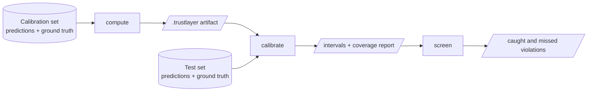

<p align="center">
  
  <br/>
</p>

# gridfm-trustlayer

**Statistically valid error bars on grid-state predictions, without retraining the model.**

A foundation model such as a GridFM power-flow model returns a point prediction: one voltage per bus, one loading per line. `gridfm-trustlayer` wraps that prediction in an interval that contains the true AC value with a probability you choose, for example 90%. It learns how large the model's errors are from scenarios where the true solution is known, and turns them into bounds for new scenarios.

The intervals make the model's output usable where a point estimate is not. In N-k contingency screening, a line is flagged when the upper bound of its predicted loading exceeds its rating. Only the flagged contingencies need a full AC power flow, and the share of real overloads that slip through is controlled by the coverage level.

## Where it fits

Trustlayer is the last step of the GridFM toolchain. It never trains or runs a model; it reads files the other two tools write.

| Step | Tool | Output that trustlayer reads |
| --- | --- | --- |
| 1. Generate scenarios and solve them | [gridfm-datakit](https://github.com/gridfm/gridfm-datakit) | ground truth: `raw/bus_data.parquet`, `raw/branch_data.parquet` |
| 2. Predict with a trained model | [gridfm-graphkit](https://github.com/gridfm/gridfm-graphkit) | predictions: `<grid>_predictions.parquet`, optionally embeddings |
| 3. Calibrate, apply, screen | **gridfm-trustlayer** | intervals, coverage reports, screening results |

Predictions from any other model work too, as long as they are written in the same parquet layout ([Data schemas](reference/schemas.md)), or passed as arrays through the [Python API](user-guide/python-api.md).

## How it works

You need two separately generated datasets with known solutions: a **calibration** set and a **test** set.



1. **`compute`** compares the model's predictions with the true values on the calibration set and stores the size of the errors in a `.trustlayer` artifact.
2. **`calibrate`** applies the artifact to the test set: every prediction gets a lower and an upper bound. Because the test set also has true values, it reports how often the bounds actually contain them (the *coverage*).
3. **`screen`** compares the bounds with operating limits, for example $V_m \in [0.95, 1.05]$ p.u. or loading $\le 100\%$, and counts the violations it catches and misses.

Once you trust the coverage on the test set, **`apply`** gives bounds for new scenarios that have no known solution, with the same artifact ([Quick start, step 6](getting-started/quickstart.md#6-use-it-on-new-scenarios)).

## Two methods

| | Stratified conformal (`cp_type: element`) | Kernel-weighted conformal (`cp_type: kernel`) |
| --- | --- | --- |
| Interval size depends on | the bus or line, and the group of the scenario (e.g. number of outages) | the bus or line, the group, **and how similar the scenario is to the calibration scenarios** |
| Coverage | guaranteed in finite samples, within each group, if calibration and test scenarios are exchangeable | checked empirically on the test set |
| Needs | predictions and ground truth | also the model's embeddings |
| Use it | as the default, and whenever a formal guarantee matters | when errors vary within a group and you want narrower bounds on easy scenarios |

[Choosing a setup](user-guide/choosing-a-setup.md) explains how to pick between them and how to group scenarios.

## Where to go next

- **New here?** [Install the package](getting-started/installation.md), then follow the [Quick start](getting-started/quickstart.md) from data generation to screening results.
- **Writing a config?** The [config builder](getting-started/config-builder.md) is a Jupyter form that shows only the options that apply, or start from one of the [example configs](https://github.com/gridfm/gridfm-trustlayer/tree/main/examples/config).
- **Calling it from your own code?** See the [Python API](user-guide/python-api.md).
- **Want the statistics?** Read the [Methodology](methodology.md).

## About

`gridfm-trustlayer` was initially developed by [Antonio Alcántara](https://antonioalcantara.com) for the [OpenGridFM](https://gridfm.org/) community, as a common trustworthiness layer for its foundation models to build on.

Contributions are welcome, from bug reports to new methods: see [CONTRIBUTING.md](https://github.com/gridfm/gridfm-trustlayer/blob/main/CONTRIBUTING.md) for how to get started, or open an issue to discuss an idea.

## Citation

If you use `gridfm-trustlayer` in your research, please cite:

```bibtex
@article{alcantara2026trustworthiness,
  title={Trustworthiness Layer for Foundation Models in Power Systems: Application to N-k Contingency Screening},
  author={Antonio Alcántara and Spyros Chatzivasileiadis},
  journal={arXiv preprint arXiv:2602.07995},
  year={2026},
  url={https://arxiv.org/abs/2602.07995}
}
```

!!! note "Pre-1.0 release"
    The statistical core is tested, but the Python API, configuration keys and artifact formats may still change between minor versions. Check the [Changelog](changelog.md) before upgrading.
